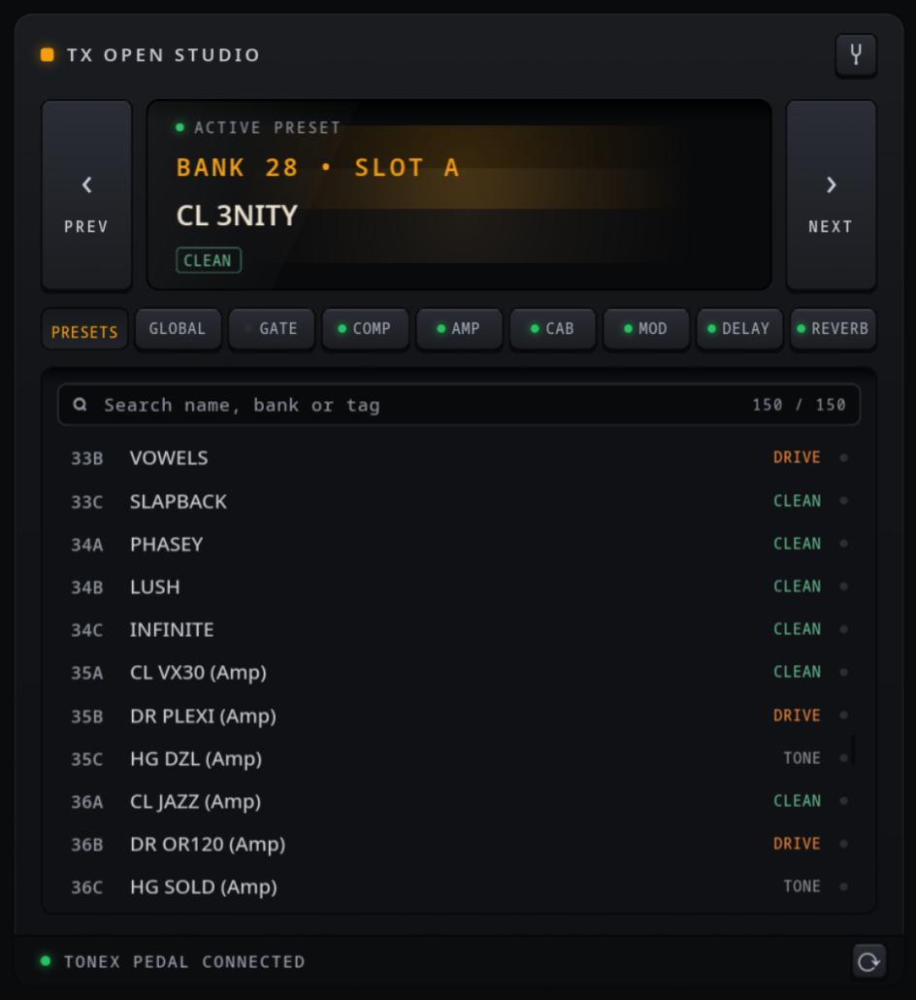
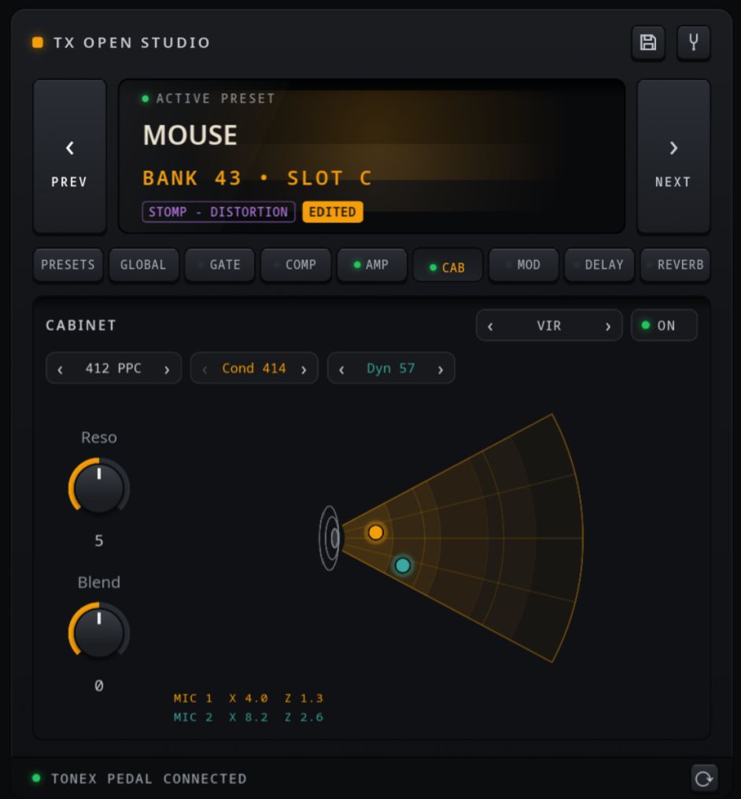
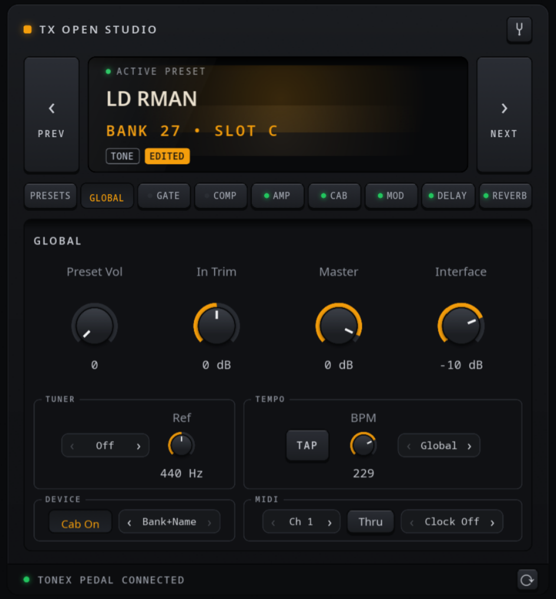
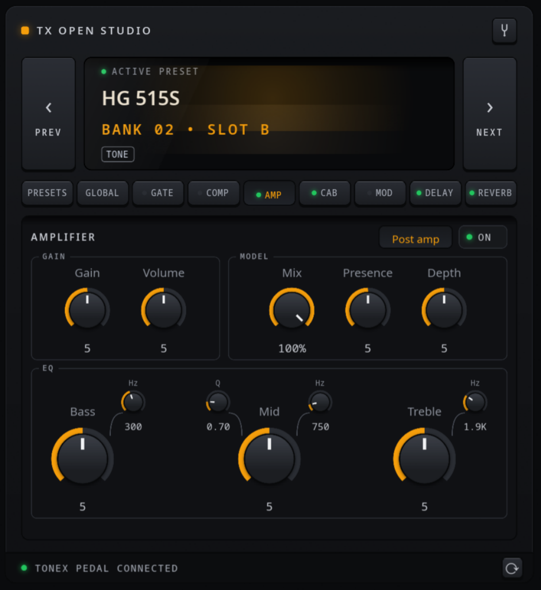

# TX Open Studio

An unofficial Linux desktop editor for the IK Multimedia TONEX Pedal: browse and switch presets, and edit the active preset live over USB.

[](https://github.com/mroldzeppelin/tx-open-studio/actions/workflows/ci.yml)
[](https://github.com/mroldzeppelin/tx-open-studio/releases/latest)
[](LICENSE)
[](https://github.com/mroldzeppelin/tx-open-studio/releases/latest)



TX Open Studio is written in Rust with the [Slint](https://slint.dev) UI toolkit. It talks to the pedal over the single USB cable, which carries a USB-MIDI port and a USB serial (CDC-ACM) port. It does not replace IK Multimedia's TONEX software. It covers the day-to-day tasks of choosing a preset and tweaking it from the desk.

## Features

**Presets**

- Lists all 150 presets with the names and "character" tags (CLEAN, DRIVE, STOMP - OVERDRIVE, ...) read from the pedal, labelled by bank and slot the way the pedal's display shows them (for example `46C`).
- Search field: every word you type must match the preset id, bank, slot, name or character (`46c`, `bank 14`, `clean`, `dg solo`). Escape clears the search.
- Keyboard navigation: Left/Right step through presets. In the search field, Down moves into the list. In the list, Up/Down move the highlight and Enter selects the preset.
- Preset switching over USB-MIDI (Bank Select CC0 + Program Change, on whatever MIDI channel the pedal is set to — the app reads it from the pedal).
- When you change presets with the footswitches, the app follows.
- The list's numbering follows the pedal's **Naming** setting (Bank+Name `46C`, 0-based `PC 083`, or names only) — change it on either side and both displays switch.

**Live editing (USB serial)**

Changes are sent to the pedal as you turn a knob in the app. Sync goes both ways: turn a knob on the pedal and the app updates. The tabs mirror the pedal's signal chain:

- **Amp**: on/off, Gain, Volume, Mix (dry/wet of the model), Presence, Depth, EQ pre/post position — and a Two-Notes-style EQ: Bass, Mid and Treble gain knobs with small frequency knobs (75–600 Hz / 150 Hz–5 kHz / 1–4 kHz) plus Q on the mid band.
- **Noise gate**: on/off, pre/post amp, Threshold, Release, Depth.
- **Compressor**: on/off, pre/post amp, Threshold, Gain, Attack.
- **Cabinet**: Tone Model (the captured cab), VIR or Off; all 40 VIR cabs by their real names (412 GRN, 212 TWIN, …), resonance, two mics (Condenser 414 / Dynamic 57 / Ribbon 121) dragged on an interactive position pad fanning out of the speaker, and mic blend.


- **Modulation**: on/off, pre/post, Chorus / Tremolo / Phaser / Flanger / Rotary with tempo sync and per-model controls.
- **Delay**: on/off, pre/post, Digital / Tape, sync or time, feedback, normal/ping-pong, mix.
- **Reverb**: on/off, pre/post, Spring 1-4 / Room / Plate, time, pre-delay, color, mix.
- **Global**: the pedal's GLOBAL SETUP without the menu diving — Preset Volume, In Trim, Master and Interface (USB) levels; tuner mode (Off / Through / Muted) and reference pitch; tap tempo (button or the T key) with the pedal's **actual BPM** read back, writable as a number, and the Global/Preset tempo mode; global cab-sim bypass; display Naming; MIDI channel, MIDI Thru and MIDI Clock mode.



Other details:

- Knobs are dragged vertically. Double-click a knob to reset it to its default value.
- An **EDITED** indicator shows when the live state differs from the preset as last loaded.
- Tuner on/off button (sent as MIDI CC 9).
- Auto-reconnect: unplug the pedal or power-cycle it and the app shows RECONNECTING, polls every 2 seconds, and resyncs everything (current preset, names, parameters, globals) when it comes back. The status bar also has a manual reconnect button.



## Supported hardware

| Device | Status |
|---|---|
| TONEX Pedal (the large floor unit, USB ID `1963:0068`) | Developed and tested on this unit. |
| TONEX ONE and other TONEX devices | **Untested.** Community references suggest the TONEX ONE uses a similar protocol with different message IDs, but the app targets the big pedal only. |

The pedal needs a firmware with IK editor support. The MIDI CC map assumes the post-November-2024 MIDI chart. If you try the app on another device or firmware, please open an issue with your results, even if nothing works.

## Install

### Prebuilt packages (no toolchain needed)

One command, straight from the [latest release](https://github.com/mroldzeppelin/tx-open-studio/releases/latest):

```sh
# Fedora
sudo dnf install https://github.com/mroldzeppelin/tx-open-studio/releases/latest/download/tx-open-studio-latest.x86_64.rpm
# Debian / Ubuntu
curl -LO https://github.com/mroldzeppelin/tx-open-studio/releases/latest/download/tx-open-studio-latest_amd64.deb
sudo apt install ./tx-open-studio-latest_amd64.deb
```

The package installs the app, the desktop entry, the icons and the udev rule, and reloads udev — plug in the pedal and launch.

**Updating:** run the same command again — it upgrades in place. The app shows an amber UPDATE chip in the status bar when a newer release is out (checked at most once a day; set `TX_NO_UPDATE_CHECK=1` to disable).

### Build from source

You need a Rust toolchain ([rustup](https://rustup.rs)) plus a C compiler, `pkg-config`, and the ALSA and fontconfig development headers (for `midir` and Slint's font handling).

Fedora:

```sh
sudo dnf install gcc pkgconf-pkg-config alsa-lib-devel fontconfig-devel
```

Debian / Ubuntu:

```sh
sudo apt install build-essential pkg-config libasound2-dev libfontconfig-dev
```

At runtime Slint also loads `libxkbcommon`, an OpenGL/EGL driver (Mesa) and the Wayland or X11 client libraries. A normal desktop install already has these.

Then build:

```sh
git clone https://github.com/mroldzeppelin/tx-open-studio.git
cd tx-open-studio
./install.sh
```

`install.sh` builds the release binary and installs it to `~/.local` together with the desktop entry and icons, and installs the udev rule (the one step that asks for sudo). To just build and run without installing:

```sh
cargo build --release
./target/release/tx-open-studio
```

### Packages

The crate has packaging metadata for [cargo-deb](https://github.com/kornelski/cargo-deb) and [cargo-generate-rpm](https://github.com/cat-in-136/cargo-generate-rpm):

```sh
cargo install cargo-deb && cargo deb
# or
cargo install cargo-generate-rpm && cargo build --release && cargo generate-rpm
```

The packages install the binary, the udev rule (to `/usr/lib/udev/rules.d/`), the desktop entry and the icons, and they reload udev on install.

### udev rule (required for editing)

The serial port (`/dev/ttyACM*`) is not accessible to normal users by default. Without access, preset names, live editing and two-way sync do not work, and the status bar shows **NO ACCESS TO /dev/ttyACM0 — INSTALL THE UDEV RULE**. The packages and `install.sh` install the rule automatically. To install it by hand:

```sh
sudo cp packaging/70-tonex-pedal.rules /etc/udev/rules.d/
sudo udevadm control --reload-rules && sudo udevadm trigger
```

Then unplug and replug the pedal. The rule grants the logged-in user access to the pedal's serial port (`TAG+="uaccess"`). No group membership is needed.

### Desktop integration (from source)

`./install.sh` does this for you; by hand:

```sh
install -Dm644 packaging/tx-open-studio.desktop ~/.local/share/applications/tx-open-studio.desktop
install -Dm644 assets/icon.png ~/.local/share/icons/hicolor/256x256/apps/tx-open-studio.png
install -Dm644 assets/icon.svg ~/.local/share/icons/hicolor/scalable/apps/tx-open-studio.svg
```

The desktop entry runs `tx-open-studio`, so the binary has to be on your `PATH` (for example `~/.local/bin`).

## Usage notes

- Connect the pedal over USB and start the app. No configuration is needed. The app connects to the first MIDI output whose name contains "TONEX" and to the `/dev/ttyACM*` port whose USB vendor is IK Multimedia (`1963`).
- The app reads the pedal's MIDI channel over serial and sends on it, so any channel works. Before the first read (or if the serial side is down, for example without the udev rule) it falls back to **channel 1**.
- Run with `TX_DEBUG_SERIAL=1` to log unhandled serial frames as hex on stderr. This is useful for protocol work and bug reports:

  ```sh
  TX_DEBUG_SERIAL=1 tx-open-studio
  ```

## Limitations

These are not on a to-do list waiting for time. Each one is either an unknown part of the protocol or something the pedal does not report.

- **Saving edits doesn't include the preset volume yet.** Presets can be renamed (right-click a preset in the list → Rename) and edits saved (hold the floppy button for 1 s while the preset shows EDITED). The preset volume is not part of the stored preset data the app writes, so a save keeps the volume stored on the pedal.
- **No upload or download of `.tonex` captures / presets.** The full preset dump is an undecoded binary blob, and no upload path is known.
- **The amp model (capture) cannot be changed.** Only the parameters around it can. The pedal does not even store model names in a readable form.
- **Preset volume is unknown until first touched.** The pedal does not include it in any identified place of the preset data. The app learns the value once you move it in the app or on the pedal.
- **The tuner shows no pitch.** The pedal sends no pitch data over USB. It also does not report tuner on/off when toggled on the pedal, so the app's tuner button only reflects what the app last sent.
- Only In Trim and Master are known among the pedal's global settings.

The full list of open questions is in [PROTOCOL.md §9](PROTOCOL.md#9-known-limitations-and-open-questions).

## Protocol

[PROTOCOL.md](PROTOCOL.md) documents the USB serial and MIDI protocol as implemented here: framing, value encoding, message types, the 109-entry parameter table and the MIDI CC map, with notes on what has been verified on hardware. The protocol was documented for interoperability by observing the pedal's USB traffic, building on earlier community work and correcting it where hardware disagreed. Thanks to:

- **Builty** — [TonexOneController](https://github.com/Builty/TonexOneController) (big-pedal driver, parameter order and ranges)
- **vit3k** — [tonex_controller](https://github.com/vit3k/tonex_controller) (framing, CRC, value encoding)
- **brunothesatellite** — [tonexpedal](https://github.com/brunothesatellite/tonexpedal) (preset name scan)
- **ThibaultDucray** — [TonexPedal-TouchOSC-Template](https://github.com/ThibaultDucray/TonexPedal-TouchOSC-Template) (MIDI CC numbers)

## License and disclaimer

TX Open Studio is free software, licensed under the GNU General Public License v3.0 or later. See [LICENSE](LICENSE).

This project is not affiliated with or endorsed by IK Multimedia. TONEX and ToneX are trademarks of IK Multimedia Production srl. Use at your own risk.
